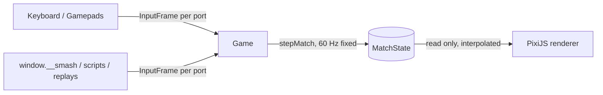

# Architecture

The game is a deterministic simulation with a renderer on top. Everything that decides the outcome of a match
lives in `src/sim` and is a pure function of the match config and the per-frame inputs.

## Simulation (`src/sim`)

- `MatchState` is plain data (numbers, strings, arrays, objects). It can be hashed (`hashState`), cloned and
  replayed. No classes, no references to renderer objects.
- `stepMatch(state, inputs)` advances exactly one 1/60 s frame. Nothing else mutates the state.
- Randomness comes from the seeded generator in `src/engine/rng.ts` whose state lives in `MatchState.rng`.
  ESLint bans `Math.random` so it cannot sneak in.
- Units follow Smash Ultimate: distances in game units (Battlefield's main platform is 160 wide), speeds in
  units per frame, time in frames. Reference numbers can then be used unchanged in code and tests.
- Inputs are `InputFrame`s: integer sticks in [-100, 100] (y up) and a button bitmask. The sim turns them into
  press edges, a 5-frame input buffer with Ultimate's hold buffer, and flick timing (dash, smash attacks, tap
  jump, fast fall, platform drop) in `src/sim/control.ts`.

## Loop (`src/engine/loop.ts`)

`FixedLoop` accumulates real time and runs whole simulation frames; the renderer receives `alpha`, the
fraction of a frame left over, and interpolates positions between the previous and current frame. A slow
display never slows or speeds the game, and a stall drops time instead of fast-forwarding.

## Replays (`src/sim/replay.ts`)

A replay is the match config plus every port's input on every frame, run-length encoded. `playReplay`
reproduces the match bit for bit; tests assert equal state hashes.

## Harness (`src/harness`)

Loading the game with `?harness` stops real-time stepping and exposes `window.__smash` (see
`src/harness/api.ts`): start a match, feed scripted inputs (`ScriptStep[]`), step frames, read or hash state,
toggle overlays and render on demand. Playwright tests and the capture harness drive the game only through it.

## Lab (`lab.html`, `src/lab`)

`/lab.html?scene=<name>` mounts one piece of the game in isolation (a fighter's poses, the stage, the HUD) on
the same 1280×720 canvas. Scenes are discovered from `src/lab/scenes/*.ts` (export `scene: LabScene`), so
adding one touches no shared file. A scene's `api` functions are callable from tests and the capture harness
through `window.__lab.call(name, ...args)`.
